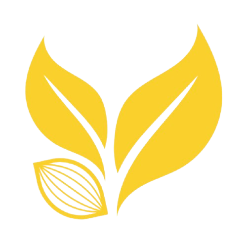

<div align="center">
  
  <h1>J-SMART CACAO</h1>
  <p><b>Dari Kebun Jembrana, Menuju Dunia</b></p>
</div>

Platform digital hulu-ke-hilir untuk ekosistem kakao premium Kabupaten Jembrana, Bali. Mengintegrasikan IoT Smart Dryer, traceability Cloud Ledger, edu-tourism 3D interaktif, dan portal agrowisata.


## Tech Stack

- **Framework:** Next.js 16 (App Router), React 19
- **Bahasa:** TypeScript
- **Styling:** Tailwind CSS
- **3D:** React Three Fiber, Three.js, Drei
- **Animasi:** Framer Motion, GSAP, Lenis
- **Data Viz:** Recharts
- **State:** Zustand
- **Scanner:** html5-qrcode

## Fitur

- **Traceability** — Pelacakan Farm-to-Bar via Cloud Ledger dan QR scanning
- **Smart Dryer** — Dashboard pemantauan suhu & kelembapan pengeringan kakao (IoT)
- **Edu-Tourism** — Eksplorasi budaya Jembrana (Jegog, Mekepung, Subak Abian) dengan model 3D interaktif
- **Agrowisata** — Portal pemesanan paket kunjungan kebun kakao
- **Bilingual** — Bahasa Indonesia & English
- **Dark/Light Mode**

## Struktur

```
src/
├── app/                  # Next.js App Router
│   ├── budaya/           # Edu-Tourism & 3D
│   ├── teknologi/        # Smart Dryer IoT
│   ├── telusuri/         # Agrowisata
│   ├── trace/            # Traceability
│   └── page.tsx          # Landing Page
├── components/
│   ├── 3d/               # React Three Fiber
│   ├── layout/           # Navbar, Footer
│   └── ui/               # Buttons, Cards, Modals
├── store/                # Zustand (Theme & Language)
└── lib/                  # Utilities
```

## Setup

```bash
git clone https://github.com/dekbintang/J-SmartCacaov2.git
cd J-SmartCacaov2
npm install
npm run dev
```

Buka `http://localhost:3000`.

## Lisensi

[MIT](LICENSE)
